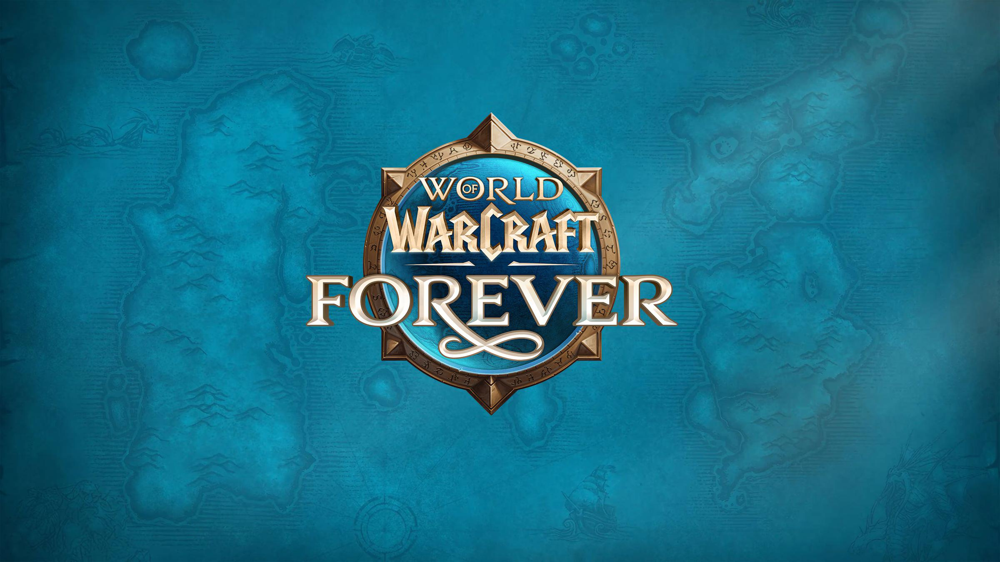

<p align="center">
  
</p>

<h1 align="center">ForeverVendors</h1>

<p align="center">
  Database-verified GM Island vendors for WoW Forever and ForeverRepack.
</p>

<p align="center">
  <a href="https://github.com/filinodz/ForeverVendors/actions"></a>
  
  
  
</p>

ForeverVendors is a safe adaptation of the classic VMaNGOS GM Island vendor
concept for the schema and item catalogue shipped with ForeverRepack. It avoids
blindly importing obsolete IDs: the builder checks the installed database and the
generated pack documents what was retained, replaced or omitted.

## Included vendors

- Nine Forever class-set collections.
- Melee, ranged and caster weapons.
- Off-hands, shields, tomes and relics.
- Off-set armor, jewelry and trinkets.
- Consumables, utility supplies and rogue poisons.
- Rare mount collection and warlock grimoires.

The current generated package uses creature entries `990000`–`990018`, spawn GUIDs
`9900000`–`9900018`, 19 vendor templates and 789 validated vendor rows.

## Files

| File | Purpose |
|---|---|
| `Custom-ADD_GM_ISLAND_VENDORS_FOREVER.sql` | Install the Forever-compatible vendors |
| `Custom-REMOVE_GM_ISLAND_VENDORS_FOREVER.sql` | Remove only this pack's reserved entries |
| `Build-Forever-Vendors.ps1` | Rebuild and validate against an installed repack |
| `FOREVER_VENDOR_AUDIT.md` | Full compatibility and item-ID audit |
| `WOWHEAD_FOREVER_VERIFIED_IDS.txt` | Curated Forever item verification cache |
| `Custom-ADD_GM_ISLAND_VENDORS.sql` | Original VMaNGOS reference script |

## Installation

1. Stop **worldserver** from Forever Launcher.
2. Back up the `world` database.
3. Import `Custom-ADD_GM_ISLAND_VENDORS_FOREVER.sql` into the `world` schema with
   HeidiSQL, Navicat or the bundled MySQL client.
4. Start the normal worldserver and wait until startup is complete.
5. Log in with a GM account and use `.tele GMIsland`.

Bundled-client example from the ForeverRepack root:

```powershell
.\mysql\bin\mysql.exe --host=127.0.0.1 --port=3317 --user=trinity --password --database=world
```

Enter the password when prompted, then run this command in the MySQL session:

```sql
SOURCE D:/Path/To/ForeverVendors/Custom-ADD_GM_ISLAND_VENDORS_FOREVER.sql;
```

The target database must be `world`. A full worldserver restart is required after
the import; importing while it is running does not refresh all creature templates.

## Verify the installation

Run these read-only checks in MySQL:

```sql
SELECT COUNT(*) AS templates
FROM world.creature_template
WHERE entry BETWEEN 990000 AND 990018;

SELECT COUNT(*) AS spawns
FROM world.creature
WHERE guid BETWEEN 9900000 AND 9900018;

SELECT COUNT(*) AS vendor_rows
FROM world.npc_vendor
WHERE entry BETWEEN 990000 AND 990018;
```

Expected results are `19`, `19` and `789`. After a successful restart,
`.npc add 990000` should also recognize the first template. If it does not, verify
that the SQL was imported into the same `world` schema used by the running
`server/worldserver.conf`.

## Removal

Stop worldserver, import `Custom-REMOVE_GM_ISLAND_VENDORS_FOREVER.sql` into
`world`, then start worldserver again. The removal script targets only this pack's
reserved IDs.

## Rebuild after a repack update

Start **Database** in Forever Launcher, then run:

```powershell
.\Build-Forever-Vendors.ps1 -RepackPath "D:\Path\To\ForeverRepack"
```

The builder reads the live schema and `world.armory_item`, validates curated IDs
and stops instead of producing a script when a required item is missing. Review the
new audit and SQL diff before importing.

## Contributing

Every item addition must exist in the target Forever database and be verified
against a reliable Forever item source. Read [`CONTRIBUTING.md`](./CONTRIBUTING.md)
before proposing vendor, position or ID changes.

## Credits and legal notice

ForeverRepack adaptation, validation pipeline, curated catalogue and documentation
by **[FilinoDZ](https://github.com/filinodz)**. The original GM Island vendor
concept and legacy reference SQL are credited to **brotalnia / VMaNGOS**.

See [`LICENSE.md`](./LICENSE.md) for the per-file licensing scope. World of Warcraft
and related names are owned by Blizzard Entertainment. This community project is
not affiliated with or endorsed by Blizzard Entertainment.
